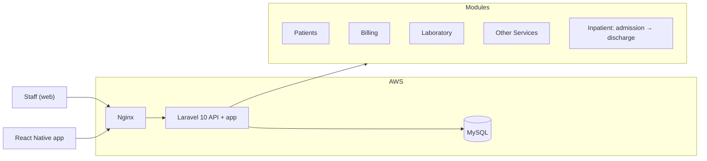
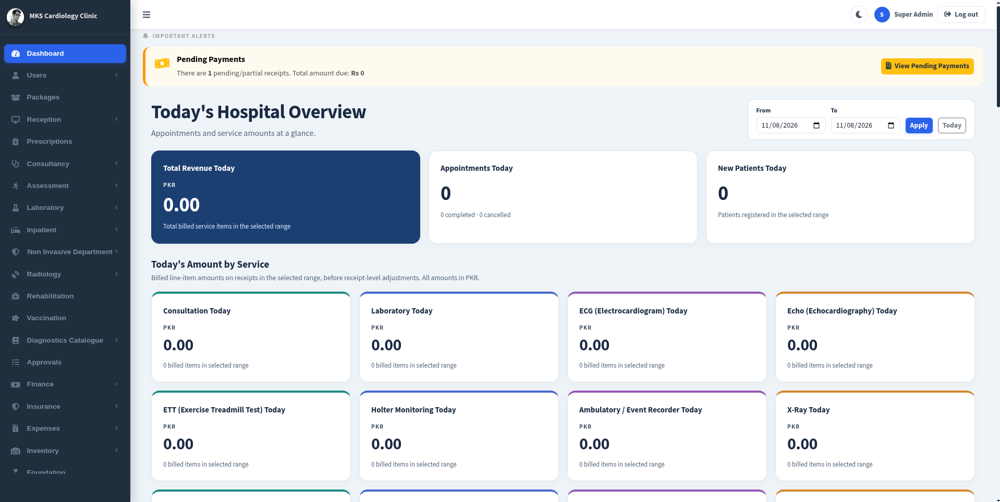
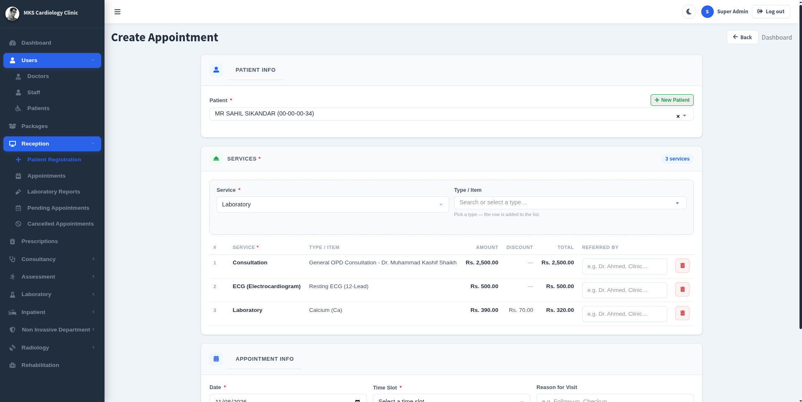
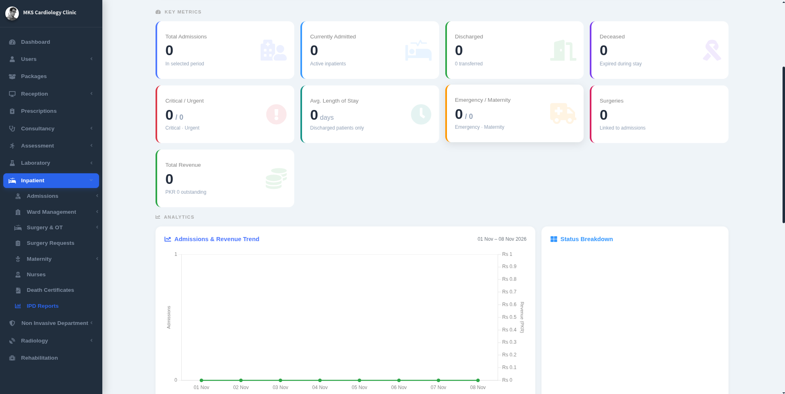
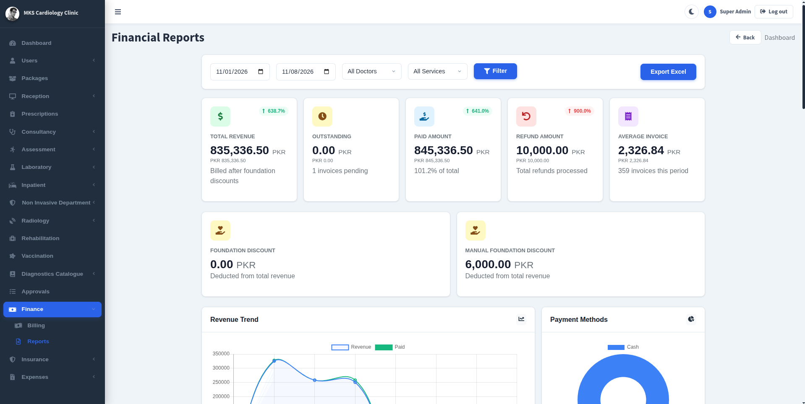
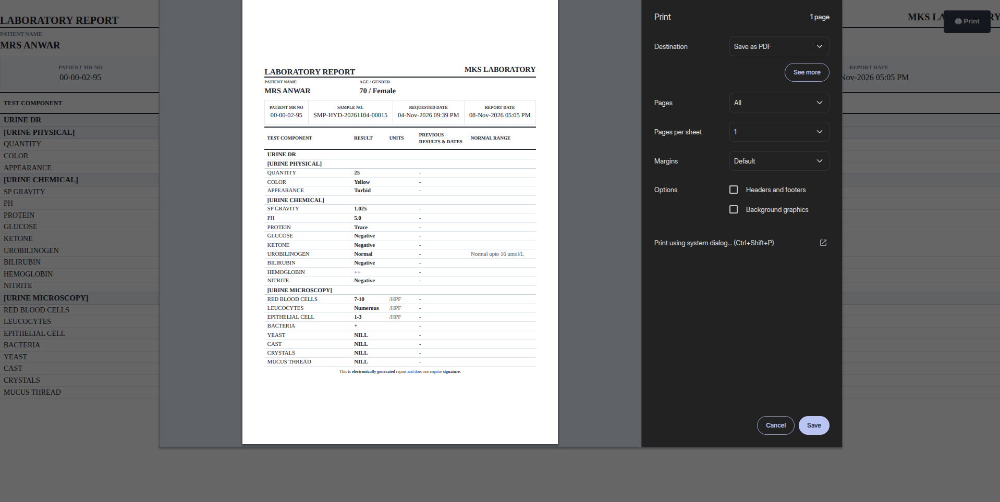
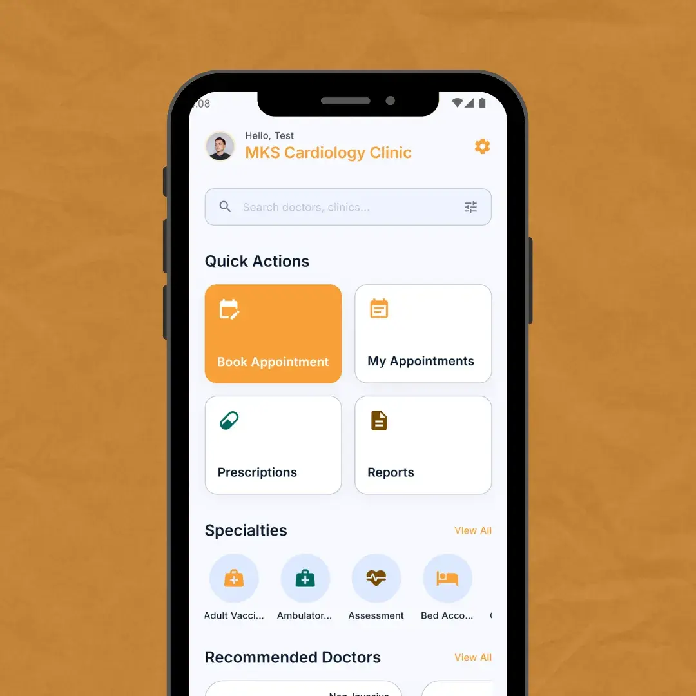

# Hospital Management System: Case Study

> Case study only. No client code, data or screenshots with real patient information are included in this repo.

**Status:** In production
**Role:** Lead and only developer, MKS Solutions
**Stack:** Laravel 10 · MySQL · React Native · AWS (EC2, RDS) · Nginx

## Problem

A polyclinic needed one system for patients, billing, laboratory, other services and inpatient care instead of separate tools.

## Solution

- Departments and role-based access for staff
- An inpatient flow from admission to discharge: beds, accruing charges, surgery scheduling, deposits, approved discounts and refunds
- Appointment booking and IPD management
- A mobile app built with React Native

## The hard part

Getting the billing rules right, Storing thousands of lab tests with their fields, and fixing production issues such as 403 errors from the Nginx root and security groups.

## How I worked

- Researched hospital workflows and reviewed the clinic's old system before writing code
- Talked each feature through with Claude until rules, edge cases and screens were written down, then built from that brief
- Turned the inpatient module (admission to discharge, bed allocation, charges, deposits, refunds) into workflow diagrams and a detailed build prompt
- Read and tested every change before it shipped

## Architecture

<!-- EDIT: add a sanitized architecture diagram, e.g. docs/architecture.png -->

## Screenshots

### Dashboard

### Create Appointment

### IPD Dashboard

### Finance Dashboard

### Laboratory Report

### Mobile App

## Results

<!-- EDIT: add real numbers you are comfortable sharing, e.g. uptime, workflows replaced -->

- Running a live polyclinic in production
- 99.9% uptime on AWS infrastructure (EC2 Instance)

## What I'd do next

Integrate AI LLMs for smart business analysis and patients health tracking.

## Links

- Portfolio: https://0xsaif.vercel.app
